<div align="center">

# 🧠 RIMA

### Safe Mental Interaction Space (*Ruang Interaksi Mental Aman*)

A privacy-focused, anonymous, offline-first, and evidence-based digital mental health platform

[](https://react.dev)
[](https://typescriptlang.org)
[](https://vite.dev)
[](https://web.dev/progressive-web-apps)
[](https://vitest.dev)
[](#-design-system--accessibility)
[](#-codebase-knowledge-graph-graphify--graphrag)
[](LICENSE)

[English](#about) · [Features](#-core-features) · [Clinical DTx](#-clinical-interventions--evidence-based-dtx) · [Agent Ecosystem](#-codebase-knowledge-graph-graphify--autonomous-agent-ecosystem) · [Tech Stack](#-tech-stack) · [Roadmap](#-roadmap--milestones) · [Getting Started](#-getting-started)

</div>

---

## 📖 About

**RIMA** (*Ruang Interaksi Mental Aman* — Safe Mental Interaction Space) is an open-source digital mental wellness platform engineered with an **offline-first, zero-knowledge, anonymous, and culturally-adaptive** architecture. Designed initially for the Indonesian mental health crisis and expanded globally, RIMA is grounded in academic research from 60+ peer-reviewed papers, clinical guidelines (WHO, NICE, APA, SAMHSA), and evidence-based psychological frameworks (CBT, DBT, ACT, CFT, Behavioral Activation, and CBT-I).

> **⚠️ Clinical Disclaimer:** RIMA is an aid for self-reflection, somatic regulation, and self-guided emotional well-being. It is **not** a diagnostic medical device or a replacement for clinical psychiatric treatment. If you are experiencing a mental health emergency, please immediately contact your local crisis hotline (Indonesia: **119 ext 8**) or visit the nearest emergency room.

### Why RIMA?

- 🇮🇩 **1 in 4 Indonesians** experience mental health challenges during their lifetime (*Riskesdas / SKI 2023*).
- 🏥 The clinical psychologist-to-population ratio is **1:400,000** (WHO recommends 1:30,000).
- 🤐 **Only ~2.6%** of distressed Indonesian adolescents access professional help (*I-NAMHS 2022*).
- 💬 Severe social stigma, fear of family shame, and digital privacy surveillance remain the greatest barriers to seeking help.

RIMA serves as a **safe, zero-judgment, completely anonymous first step** — allowing users to reflect, regulate, and safely bridge to professional healthcare when needed without leaving a digital footprint.

---

## ✨ Core Features

### 🌿 Modern Minimalist UI & Serene UX
- **Zen Monastic & Apple Health Wellbeing Design**: Calming interface engineered to reduce cognitive overload and visual sensory stress.
- **Header Hening**: Ambient greeting with subtle presence badges and non-judgmental indicators.
- **Pilihan Hening (4 Quiet Hierarchical Cards)**: Replaces cluttered button grids with organized, spacious pathways:
  1. *Jurnal & Refleksi* (Journal, Psychometrics, Psychoeducation)
  2. *Regulasi Somatik* (Brown Noise Soundscapes, Stanford Breathwork, 5-4-3-2-1 Grounding)
  3. *Welas Asih & Koping* (Self-Compassion CFT, DBT TIPP Crisis, Behavioral Activation, ACT Therapy)
  4. *Jaring Pengaman & Bantuan* (Safety Plan, 119 Ext 8, BPJS/Puskesmas Referral Bridge)
- **Fluid Mood Check-In & Grouped Factors**: Emotion logging with 4 clear domains (*Diri Sendiri, Hubungan Sosial, Beban Aktivitas, Kondisi Fisik*) avoiding choice fatigue.
- **Mindful Momentum (Compassionate Streaks)**: Eliminates guilt-inducing toxic streaks. Progress honors presence and includes *Recovery Days* (*"Istirahat juga bagian dari pemulihan"*).

### 🌐 Public Landing Page & Dual-Identity Onboarding (`/landing`)
- **Modern Minimalist Public Gateway**: Frosted glass hero layout introducing RIMA's core values under Indonesian Privacy Law (UU PDP No. 27/2022).
- **Dual Call-to-Action (Dual CTA)**:
  1. *Mulai sebagai Tamu Anonim*: 1-click instant entry to the dashboard with zero registration, zero email, and zero tracking.
  2. *Masuk dengan Akun*: Optional passwordless authentication via Supabase Magic Link OTP.
- **In-App Incognito Switch (`isAnonymousMode`)**: Dedicated toggle pill in Header and Profile. When active, public forum posts use randomized pseudonym avatars (*"Calm River"*, *"Kupu-kupu Berani"*), keeping records strictly separated from personal accounts.
- **SPA Web Hosting Compatibility**: Native `vercel.json` and `netlify.toml` URL rewrites preventing 404 errors on deep linking.

### 🛡️ Dual-Mode Engine: Air-Gapped Vault vs Connected Hybrid
- **Header & Profile Mode Switch (`useDualMode`)**:
  - **🛡️ Mode Luring Penuh (Air-Gapped Vault)**: Programmatically blocks all outgoing external network calls. All logs, journals, and screenings remain 100% inside local device storage for total peace of mind.
  - **🌐 Mode Tersambung (Connected Hybrid)**: Enables optional community sharing in Quiet Circles and cloud synchronization.
- **Air-Gapped Community Gating**: Empathetic in-page prompt in Forum explaining offline isolation with a single-tap connection switch.

### 🆘 Comprehensive Crisis Infrastructure & Fast-Action Safety Card
- **Fast-Action Emergency Safety Card (`FastActionSafetyCard.tsx`)**: High-contrast, single-tap crisis card designed for acute cognitive constriction during panic or severe overwhelm:
  - Immediate 1-tap call to primary trusted contact with sanitized `tel:` link.
  - 1-tap connection to **119 Ext 8** (SEJIWA Kemenkes RI).
  - Quick somatic de-escalation shortcut (Cyclic Sighing & Grounding).
  - Modal keyboard focus trapping compliant with WCAG 2.2 AA.
- **Always-Accessible SOS Button**: Persistent floating action button with accessible ARIA labeling.
- **Digital Safety Plan (`/safety`)**: Interactive crisis blueprint following the Stanley-Brown Safety Planning Intervention (SPI).
- **Verified Active Indonesian Crisis Lines (2026)**:
  - SEJIWA / Healing 119 (Kemenkes RI): `119 ext 8` (24 Jam)
  - Panggilan Darurat Bebas Pulsa: `112`
  - Ambulans & Gawat Darurat Medis: `119`
  - Yayasan Pulih: `021-788-42580`

### 🔒 Client-Side Cryptography & Statutory Privacy (UU PDP)
- **Zero-Knowledge Web Crypto Vault (`cryptoVault.ts`)**: AES-GCM-256 client-side encryption. Keys derived via PBKDF2 (600,000 iterations for SHA-256 per OWASP recommendations) with unique 16-byte random salts and 12-byte initialization vectors.
- **Quiet Circles & Forum E2EE**: Forum posts are transparently encrypted client-side using Web Crypto before synchronization, keeping post content shielded as `[Terkunci E2EE]`.
- **IndexedDB Storage & Persistence API**: Resilient asynchronous storage (`rimaAsyncStorage`) with automatic `navigator.storage.persist()` registration preventing browser cache eviction on Android and iOS Safari.
- **Defensive Storage Resilience**: Defensive JSON parsing guards against runtime storage corruptions and malformed states.
- **App Security PIN Lock**: 4-digit numeric PIN protection with auto-lock on inactivity.
- **One-Click Permanent Data Erasure (`wipeAllData`)**: Full compliance with Right to Erasure under Indonesian Law No. 27/2022 (UU PDP).

---

## 🧬 Clinical Interventions & Evidence-Based DTx

RIMA integrates a comprehensive digital therapeutics (DTx) suite grounded in clinical RCTs:

```mermaid
flowchart TD
    A["RIMA Clinical Engine"] --> B["Cognitive & Behavioral"]
    A --> C["Somatic & Distress Tolerance"]
    A --> D["Psychometrics & Screening"]
    A --> E["Adaptive Intelligence (JITAI)"]

    B --> B1["CBT 5-Step Wizard"]
    B --> B2["Behavioral Activation (BA)"]
    B --> B3["ACT Therapy (Values & Defusion)"]
    B --> B4["Relapse Prevention Plan"]

    C --> C1["DBT TIPP Crisis Hub"]
    C --> C2["Somatic 5-4-3-2-1 Grounding"]
    C --> C3["Stanford Cyclic Sighing"]
    C --> C4["Soundscapes & Somatics"]

    D --> D1["PHQ-9 Depression Screener"]
    D --> D2["GAD-7 Anxiety Screener"]
    D --> D3["WHO-5 Well-Being Index"]
    D --> D4["C-SSRS Suicide Risk Screener"]

    E --> E1["Local JITAI Recommendation Engine"]
    E --> E2["Sleep-Mood Multimodal Correlator"]
    E --> E3["Clinical Conversational AI & RAG"]
```



### 1. Acceptance & Commitment Therapy (ACT) (`/act`)
*Grounded in the Hexaflex Model by Steven C. Hayes et al.*:
- **Kompas Nilai Hidup (*Values Clarification*)**: Guided exploration of 4 core life domains (Relationships & Connection, Personal Growth, Health & Vitality, Work & Contribution) with 1–10 priority scoring and concrete micro-action commitments.
- **Defusi Kognitif (*Cognitive Defusion*)**:
  - *Daun di Aliran Sungai (Leaves on a Stream)*: Interactive, serene animation visualizing thoughts flowing down a river without judgment or struggle.
  - *Reframing Language Patterns*: Interactive reframing exercises transforming fused self-identifications (*"Aku gagal"*) into defused observations (*"Aku menyadari bahwa pikiranku sedang berkata bahwa aku gagal"*).

### 2. Rencana Antisipasi Kambuh / Relapse Prevention (`/relapse-prevention`)
*Grounded in Marlatt & Gordon's Cognitive-Behavioral Relapse Prevention Model*:
- **Pemetaan Tanda Peringatan Dini (*Early Warning Signs*)**: Identification of subtle precursors (sleep disruption, social withdrawal, emotional hypersensitivity).
- **Protokol De-eskalasi 3-Langkah**: Step-by-step calming routine before distress escalates into acute crisis.
- **Penawar *Abstinence Violation Effect***: Cognitive self-compassion affirmations preventing all-or-nothing despair (*"Kemunduran adalah bagian dari proses belajar dan pemulihan, bukan tanda kegagalan"*).

### 3. On-Device JITAI Engine (Just-In-Time Adaptive Interventions)
- **Zero-Network Contextual Intelligence**: Deterministic on-device engine analyzing local mood trajectories and CBT-I sleep patterns to display dismissible whisper nudges on the dashboard.
- **Multimodal Sleep-Mood Correlator**: Links low sleep efficiency ($<70\%$ from `sleepService.ts`) with high-arousal negative mood quadrants (Red Quadrant) to surface timely restorative nudges (e.g., ACT Cognitive Defusion or rest protocols).

### 4. Behavioral Activation (BA) (`/activation`)
*Grounded in the Indonesian RCT by Arjadi et al. (2018), The Lancet Psychiatry*:
- 4 culturally tailored domains (Pleasure, Mastery, Spiritual, Social) with 16 low-barrier micro-actions.
- Activity scheduling with pre-activity mood prediction (1–10) and post-completion reflection to calculate $\Delta\text{Mood} = \text{Actual} - \text{Predicted}$.

### 5. Interactive 5-Step CBT Wizard (*Pembedah Pikiran*) (`/journal`)
*Based on Beck & Burns Cognitive Therapy Taxonomies*:
- 5-step structured mobile thought record: Trigger $\rightarrow$ Automatic Thought $\rightarrow$ Cognitive Distortion Classifier (8 clinical traps) $\rightarrow$ Evidence Examination $\rightarrow$ Balanced Reframe with pre/post SUDS relief feedback.

### 6. DBT TIPP Crisis Hub (`/tipp`)
*Distress tolerance protocol from Dialectical Behavior Therapy (Linehan 2014)*:
- **T — Temperature**: 30s cold water timer activating the *Mammalian Dive Reflex* (vagal stimulation).
- **I — Intense Exercise**: 60s motor discharge timer to burn panic-induced adrenaline.
- **P — Paced Breathing**: Baroreflex resonance breathing pacer.
- **P — Paired Muscle Relaxation (PMR)**: 5-zone body cycle alternating 5s tension and 10s release.

### 7. CBT-I Sleep Diary & Efficiency Tracker (`/sleep`)
*Digital Cognitive Behavioral Therapy for Insomnia (van Straten et al., 2018)*:
- Clinical Sleep Efficiency calculator: $\text{SE} = (\text{Total Sleep Time} / \text{Time in Bed}) \times 100\%$.
- 20-minute Stimulus Control protocol with direct redirection to low-stimulation somatic grounding.

### 8. Standardized Psychometrics & C-SSRS Suicide Triage (`/assessment`)
- Indonesian-validated **PHQ-9** & **GAD-7** (*Arjadi et al., 2024, Asian J Psychiatry*).
- **WHO-5 Well-Being Index**: Non-stigmatizing positive psychological vitality screener.
- **Columbia-Suicide Severity Rating Scale (C-SSRS)**: Standardized 6-item suicide risk screener automatically triggered on PHQ-9 Item 9 positive endorsement ($\ge 1$), replacing blunt modal popups with clinical risk stratification (Minimal, Low, Moderate, High).

### 9. Clinical Conversational AI Chatbot & On-Device RAG
- **Trauma-Informed Conversational Assistant (`ChatbotDrawer.tsx`)**: Private, supportive chat drawer for emotional reflection and psychoeducation guidance.
- **Zero-Delusion Psychiatric Guardrails**: Built strictly on WHO Digital Health, APA App Advisor, NICE ESF, and FDA SaMD principles. Refuses medical diagnosis, medication advice, or sycophantic delusions.
- **Local Psychoeducation RAG**: In-browser semantic retrieval from evidence-based articles without leaking personal queries to external servers.

---

## 🤖 Codebase Knowledge Graph (Graphify) & Autonomous Agent Ecosystem

RIMA integrates advanced developer and agent tooling inside `.agents/`:

### A. Graphify Codebase Knowledge Graph & GraphRAG
The entire RIMA codebase (186 files) is mapped into an AST-based Knowledge Graph in [`graphify-out/`](./graphify-out/) with zero LLM API cost using `tree-sitter`:
- **839 Nodes** · **2,513 Edges** · **30 Communities**
- **Interactive Visual Graph**: [`graphify-out/graph.html`](./graphify-out/graph.html)
- **GraphRAG JSON Data**: [`graphify-out/graph.json`](./graphify-out/graph.json)
- **Architecture Report**: [`graphify-out/GRAPH_REPORT.md`](./graphify-out/GRAPH_REPORT.md)
- **Fast Traversal CLI**:
  ```bash
  graphify query "How does dual mode work in AppShell?"
  graphify path "App" "actStore"
  graphify explain "src/stores/dualModeStore.ts::dualModeStore.ts"
  ```

### B. 7 Curated Agent Skill Packages (`.agents/skills/`)
Structured under Google Antigravity & `agentskills.io` standards with valid YAML frontmatter:
1. [`.agents/skills/librechat/`](./.agents/skills/librechat/): SSE streaming loops, Sandpack isolated iframe artifacts, MCP client architecture, and tree DAG session branching.
2. [`.agents/skills/awesome-agent-skills/`](./.agents/skills/awesome-agent-skills/): Cross-harness productivity and software engineering playbook catalog (Antigravity, Claude Code, Cursor, Gemini CLI).
3. [`.agents/skills/anthropic-cybersecurity-skills/`](./.agents/skills/anthropic-cybersecurity-skills/): NIST CSF 2.0, NIST AI RMF, MITRE ATT&CK, Web Crypto validation, and UU PDP privacy auditing.
4. [`.agents/skills/aion-ui/`](./.agents/skills/aion-ui/): Multi-agent workspace isolation via Git worktrees, ACP subagent supervision, and atomic file patterns.
5. [`.agents/skills/claude-skills/`](./.agents/skills/claude-skills/): Zero-dependency software engineering modules, 3-persona adversarial review, and architectural linting.
6. [`.agents/skills/ai-guide/`](./.agents/skills/ai-guide/): Vibe Coding harness engineering, creative briefs, and TDD prompt development.
7. [`.agents/skills/generic-agent/`](./.agents/skills/generic-agent/): Self-Evolving Skill Tree (workflow crystallization) and context density compression (<30K tokens).
8. [`.agents/rules/agent_skill_guardrails.md`](./.agents/rules/agent_skill_guardrails.md): System-wide always-on rule enforcing YAML standards, context budgets, offline integrity, and zero telemetry.

---

## 🌐 8 Supported Popular Languages

Full 100% translation parity across **1,000+ UI leaf keys** with zero missing translations:

| Flag | Language | Code | Clinical & Cultural Focus |
|:---:|:---|:---:|:---|
| 🇮🇩 | **Bahasa Indonesia** | `id` | Default national language, Indonesian medical terms |
| 🇬🇧 | **English** | `en` | International clinical psychology terminology |
| 🇮🇩 | **Basa Jawa** | `jv` | Javanese cultural adaptation (*Krama Madya*) |
| 🇮🇩 | **Basa Sunda** | `su` | Sundanese cultural adaptation (*Basa Lemes*) |
| 🇯🇵 | **日本語** | `ja` | Japanese mindfulness phrasing (*Teineigo*) |
| 🇨🇳 | **简体中文** | `zh` | Simplified Chinese wellness phrasing |
| 🇪🇸 | **Español** | `es` | Spanish emotional descriptors |
| 🇸🇦 | **العربية** | `ar` | Modern Standard Arabic with native RTL layout |

---

## 🏗️ Tech Stack

| Layer | Technology | Rationale & Description |
|:------|:-----------|:------------------------|
| **Core Framework** | React 19 + TypeScript 6.0 | Concurrent React root with strict type checking |
| **Build & Tooling** | Vite 8.2 + Rolldown | High-speed ESM bundler and manual chunk partitioning |
| **State Management**| Zustand 5 | Modular stores (`moodStore`, `actStore`, `relapseStore`, `dualModeStore`) with automated persistence |
| **Styling** | Vanilla CSS + Pure Design Tokens | **Strictly Zero Tailwind CSS**, dark-mode-first, desaturated low-stimulation mode |
| **Routing** | React Router DOM 7 | Code-split client-side SPA routing with calm Suspense fallbacks |
| **Cryptography** | Web Crypto API | AES-GCM-256 + PBKDF2 (600,000 iterations) client-side encryption vault |
| **Offline Storage** | IndexedDB + Storage Persistence API | High-capacity local database with `navigator.storage.persist()` registration |
| **Visual Analytics**| Recharts 3 | Responsive, privacy-preserving SVG charting |
| **Localization** | i18next + react-i18next | Multi-language localization across 8 languages + RTL Arabic |
| **PWA & Service Worker**| vite-plugin-pwa + Workbox | 62 precached offline assets, mobile-installable PWA |
| **Cloud Sync** | Supabase (PostgreSQL + RLS) | Optional E2EE community discussions with row-level security |
| **Knowledge Graph** | Graphify + Tree-Sitter | Deterministic codebase graph (839 nodes, 2,513 edges) for local GraphRAG |
| **Deployment** | Vercel & Netlify Ready | SPA rewrite routing configurations (`vercel.json`, `netlify.toml`) |

---

## 📁 Project Structure

```
mental monitoring/
├── .agents/                          # Autonomous agent configurations
│   ├── rules/                        # Always-on system rules
│   │   ├── agent_skill_guardrails.md # Token budget, privacy, and quality invariants
│   │   └── graphify.md               # Codebase graph querying rule
│   ├── skills/                       # Modular agent skills (Antigravity & agentskills.io)
│   │   ├── act-therapy/              # ACT therapy implementation guidance
│   │   ├── ai-guide/                 # Vibe Coding & harness engineering
│   │   ├── aion-ui/                  # Multi-agent workspace isolation & ACP
│   │   ├── anthropic-cybersecurity-skills/ # NIST CSF 2.0, AI RMF, Web Crypto audit
│   │   ├── awesome-agent-skills/     # Cross-tool productivity skill catalog
│   │   ├── claude-skills/            # Zero-dependency software engineering
│   │   ├── generic-agent/            # Self-evolving skill trees (<30K tokens)
│   │   ├── graphify/                 # GraphRAG knowledge graph CLI & references
│   │   ├── librechat/                # SSE streaming, isolated iframe artifacts, MCP
│   │   └── rima-*/                   # Specialized RIMA domain skills
│   └── workflows/
│       └── graphify.md               # /graphify slash command workflow
├── graphify-out/                     # Codebase Knowledge Graph artifacts
│   ├── graph.json                    # Full GraphRAG JSON data (839 nodes, 2,513 edges)
│   ├── graph.html                    # Interactive visual graph canvas
│   └── GRAPH_REPORT.md               # Core abstractions & community hubs report
├── public/
│   ├── favicon.svg                   # RIMA logo icon
│   └── icons/                        # High-resolution PWA manifest icons
├── src/
│   ├── components/
│   │   ├── auth/                     # AuthModal.tsx, IncognitoPillToggle.tsx
│   │   ├── cft/                      # SelfCompassionModal.tsx (CFT micro-exercise)
│   │   ├── chatbot/                  # ChatbotDrawer.tsx (Clinical mental AI chat)
│   │   ├── common/                   # ClinicalDisclaimer, ConsentModal, JitaiNudgeCard, PageFallbackLoader
│   │   ├── journal/                  # CbtWizard.tsx (5-step thought restructuring)
│   │   ├── layout/                   # AppShell, BottomNav, Sidebar, DualModePillToggle
│   │   ├── mood/                     # GroupedMoodFactorSelector, MoodSelector
│   │   ├── safety/                   # FastActionSafetyCard, CrisisInterceptor, SOSButton, SafetyPlan
│   │   ├── security/                 # AppLockScreen, SetPinModal (PIN encryption)
│   │   ├── somatics/                 # SoundscapePlayer.tsx (Brown Noise Web Audio)
│   │   └── ui/                       # Button, Card, Input, Modal, MoodMeterCanvas
│   ├── pages/
│   │   ├── ActTherapy.tsx            # /act - Acceptance & Commitment Therapy
│   │   ├── Analytics.tsx             # /analytics - Local visual analytics
│   │   ├── Assessment.tsx            # /assessment - PHQ-9, GAD-7, WHO-5 & C-SSRS
│   │   ├── BehavioralActivation.tsx  # /activation - Activity scheduling & mood link
│   │   ├── Breathe.tsx               # /breathe - Cyclic sighing & Stanford breathwork
│   │   ├── Education.tsx             # /education - Psychoeducation library
│   │   ├── Forum.tsx                 # /forum - Anonymous peer support with E2EE
│   │   ├── Grounding.tsx             # /grounding - Somatic 5-4-3-2-1 grounding
│   │   ├── Home.tsx                  # / - Modern Minimalist dashboard
│   │   ├── Journal.tsx               # /journal - CBT wizard & journaling
│   │   ├── Landing.tsx               # /landing - Public modern minimalist landing page
│   │   ├── MoodTracker.tsx           # /mood - Yale Mood Meter & factor logging
│   │   ├── PrivacyPolicy.tsx         # /privacy - Statutory UU PDP policy
│   │   ├── ProfessionalHelp.tsx      # /professional - Directory & BPJS referral bridge
│   │   ├── Profile.tsx               # /profile - Dual-mode, PIN lock, data wipe
│   │   ├── RelapsePrevention.tsx     # /relapse-prevention - Marlatt & Gordon relapse plan
│   │   ├── SleepTracker.tsx          # /sleep - CBT-I sleep efficiency diary
│   │   └── TippCrisisHub.tsx         # /tipp - DBT TIPP somatic crisis hub
│   ├── services/
│   │   ├── assessmentService.ts      # Clinical psychometrics scoring & cutoffs
│   │   ├── audioSomaticsService.ts   # Web Audio acoustic singing bowl & soundscapes
│   │   ├── behavioralActivationService.ts # BA domain scheduling & delta mood
│   │   ├── chatbotEngine.ts          # Non-diagnostic psychiatric chatbot engine
│   │   ├── clinicalRagService.ts     # Local psychoeducation semantic RAG
│   │   ├── crisisDetectionService.ts # Client-side distress NLP keyword matcher
│   │   ├── cssrsService.ts           # Standardized Columbia suicide severity triage
│   │   ├── escalationService.ts      # Tiered mental healthcare escalation
│   │   ├── forumService.ts           # Quiet circles CRUD with client-side E2EE
│   │   ├── jitaiEngine.ts            # Just-In-Time Adaptive Intervention engine
│   │   ├── referralService.ts        # BPJS Puskesmas referral letters & handover
│   │   ├── safetyCardService.ts      # Fast-Action emergency contact logic
│   │   ├── sleepService.ts           # CBT-I sleep efficiency calculations
│   │   └── streakService.ts          # Mindful momentum & compassionate recovery days
│   ├── stores/
│   │   ├── actStore.ts               # ACT values & cognitive defusion store
│   │   ├── dualModeStore.ts          # Air-gapped vs connected hybrid store
│   │   ├── moodStore.ts              # Mood logs & factor tracking store
│   │   └── relapseStore.ts           # Early warning signs & relapse prevention store
│   ├── styles/
│   │   ├── design-tokens.css         # Pure CSS variables (colors, z-index, typography)
│   │   ├── components.css            # Component utility classes (zero Tailwind)
│   │   └── index.css                 # Base layout, responsive docking, RTL support
│   └── utils/
│       ├── cryptoVault.ts            # Client-side AES-GCM-256 Web Crypto vault
│       ├── dataWipe.ts               # 1-click permanent data erasure (UU PDP)
│       ├── exportImport.ts           # JSON backups, sanitized CSV, clinical HTML brief
│       ├── indexedDb.ts              # Resilient async IndexedDB storage adapter
│       └── security.ts               # PIN PBKDF2 salted hashing & rate limiting
├── netlify.toml                      # Netlify SPA rewrite configuration
├── vercel.json                       # Vercel SPA rewrite configuration
├── vite.config.ts                    # Rollup manual chunk partitioning & Workbox SW
└── package.json
```

---

## 🚀 Getting Started

### Prerequisites

- [Node.js](https://nodejs.org) v18.0.0 or higher
- [npm](https://www.npmjs.com) v9.0.0 or higher
- *(Optional for Graphify)* Python 3.10+ in `.venv` with `graphifyy`

### Installation

```bash
# 1. Clone the repository
git clone https://github.com/your-username/rima.git
cd rima

# 2. Install project dependencies
npm install

# 3. Start local development server
npm run dev
```

Open **http://localhost:5173/** in your browser.

### Available Scripts

| Command | Description |
|:--------|:------------|
| `npm run dev` | Start development server with Hot Module Replacement (HMR) |
| `npm run build` | Compile TypeScript and build production PWA bundle with Vite & Workbox |
| `npm run preview` | Locally preview the production build |
| `npm test` | Run Vitest unit & integration test suite (**662 tests across 65 test files, 100% passing**) |
| `npm run lint` | Run code quality checks with `oxlint` (0 errors, 0 warnings across 174+ files) |

---

## 🎨 Design System & Accessibility

RIMA incorporates a trauma-informed design system tailored for mental wellness:

### Color Palette

| CSS Token | HSL / Hex | Psychological Rationale |
|:----------|:----------|:------------------------|
| `--color-primary` | `hsl(215, 65%, 55%)` | Soft Blue — Calming, dependable, non-threatening |
| `--color-secondary` | `hsl(165, 45%, 50%)` | Sage Teal — Harmony, emotional renewal |
| `--color-accent` | `hsl(270, 50%, 65%)` | Lavender — Mindfulness, creative reflection |
| `--color-warm` | `hsl(35, 75%, 60%)` | Amber Gold — Warmth, optimism, gentle encouragement |
| `--color-danger` | `hsl(0, 65%, 55%)` | Crimson — Crisis urgency and SOS differentiation |

### Design Standards
- **Zero Tailwind CSS**: Built with pure CSS design tokens, eliminating build bloat and framework lock-in.
- **Dark Mode by Default**: Minimizes eye strain during evening or nighttime distress.
- **Mode Sensori Tenang (`data-sensory="low-stimulation"`)**: Desaturated earthy paper palette for sensory overwhelm, ADHD, and autism.
- **Motion Restraint**: Full synchronization with `prefers-reduced-motion`.
- **WCAG 2.2 AA Conformance**: Strict contrast ratios, focus rings, and $\ge 48\text{px}$ touch targets.

---

## 🗺️ Roadmap & Milestones

- [x] **Phase 1 — Foundation**: React 19, TypeScript, PWA, trauma-informed design tokens, mood tracker, journaling.
- [x] **Phase 2 — Backend & Synchronization**: Supabase integration, offline fallback, data export (JSON/CSV/HTML).
- [x] **Phase 3 — Intelligence & Psychoeducation**: Distress keyword detection, psychoeducation library, guided breathing.
- [x] **Phase 4 — Scalability & Cultural Localization**: Regional language pilot (Javanese), directory of 25 verified Indonesian clinics.
- [x] **Phase 5 — Security & UU PDP Compliance**: Statutory privacy page (`/privacy`), consent modal, one-click data wipe.
- [x] **Phase 6 — Popular Multi-Language Expansion**: 100% translation parity across 8 languages (`id`, `en`, `jv`, `su`, `ja`, `zh`, `es`, `ar`).
- [x] **Phase 7 — Evidence-Based Clinical Interventions**: CBT 5-step wizard, DBT TIPP crisis hub, somatic 5-4-3-2-1 grounding, C-SSRS screener, Behavioral Activation, BPJS referral bridge.
- [x] **Phase 8 — Modern Minimalist UI & Public Landing Page**: Zen Monastic redesign, 4 quiet card rows, public landing page with 1-click anonymous guest entry and Supabase Magic Link OTP.
- [x] **Phase 9 — Cognitive Load Reduction & Dual-Mode Engine**: Mindful Momentum (no toxic streaks), 4-domain factor categorization, 100% offline air-gapped vault mode blocking network calls.
- [x] **Phase 10 — Advanced Clinical DTx Modules**: Acceptance & Commitment Therapy (ACT), Relapse Prevention Plan, Quiet Circles Forum with client-side Web Crypto AES-GCM-256 E2EE, and multimodal JITAI engine.
- [x] **Phase 11 — Clinical Conversational AI & Local RAG**: Non-diagnostic psychiatric chatbot with strict ethical boundaries, local psychoeducation semantic retrieval, and suicide crisis triage.
- [x] **Phase 12 — Codebase Knowledge Graph & Autonomous Agent Ecosystem**: Graphify AST knowledge graph (839 nodes, 2,513 edges) in `graphify-out/` and 7 curated agent skills in `.agents/skills/`.

---

## 📚 Academic & Research Foundations

RIMA is constructed on empirical findings from **60+ academic publications, randomized controlled trials (RCTs), and clinical guidelines**:

- **Arjadi, R., Nauta, M.H., Scholte, W.F., et al.** *Internet-based behavioural activation with lay counsellor support versus online minimal psychoeducation for depressed adults in Indonesia: a randomised controlled trial.* **The Lancet Psychiatry**, 5(8), 647–658. (2018)
- **Hayes, S.C., Strosahl, K.D., & Wilson, K.G.** *Acceptance and Commitment Therapy: The Process and Practice of Mindful Change (2nd ed.).* Guilford Press. (2011)
- **Marlatt, G.A. & Gordon, J.R.** *Relapse Prevention: Maintenance Strategies in the Treatment of Addictive Behaviors.* Guilford Press. (1985)
- **Balban, M.Y., Spiegel, D., Huberman, A.D., et al.** *Brief structured respiration practices enhance mood and reduce physiological arousal.* **Cell Reports Medicine**, 4(1), 100895. (2023)
- **Linehan, M.M.** *DBT Skills Training Manual (2nd ed.).* Guilford Press. (2014)
- **Valentine, S.E., et al.** *The use of dialectical behavior therapy skills training as stand-alone treatments: A systematic review.* **Psychiatry Research**, 229(3), 675–685. (2015)
- **van Straten, A., et al.** *Cognitive & Behavioral Therapies in the treatment of Insomnia: A meta-analysis.* **Sleep Medicine Reviews**, 38, 152–167. (2018)
- **Arjadi, R., et al.** *Diagnostic accuracy and clinical validity of the Indonesian versions of PHQ-9 and GAD-7.* **Asian Journal of Psychiatry**, 92, 103890. (2024)
- **Stanley, B. & Brown, G.K.** *Safety Planning Intervention: A Brief Intervention to Mitigate Suicide Risk.* **Cognitive and Behavioral Practice**, 19(2), 256–264. (2012)
- **World Health Organization (WHO)**. *Guidelines on Digital Interventions for Health System Strengthening.* (2019)
- **National Institute for Health and Care Excellence (NICE)**. *Evidence Standards Framework for Digital Health Technologies.* (2021)
- **American Psychiatric Association (APA)**. *The App Advisor Evaluation Framework for Mental Health Apps.* (2021)
- **Indonesian Ministry of Health (Kemenkes RI)**. *Riset Kesehatan Dasar (Riskesdas 2018) & Survei Kesehatan Indonesia (SKI 2023).*

📖 For the full multidisciplinary scientific dossier, see [`RESEARCH_FOUNDATIONS.md`](./RESEARCH_FOUNDATIONS.md).

---

## 🤝 Contributing

Contributions are warmly welcomed! To contribute to RIMA:

1. Fork the repository
2. Create a dedicated feature branch (`git checkout -b feature/amazing-feature`)
3. Commit your modifications (`git commit -m 'Add amazing feature'`)
4. Push to your branch (`git push origin feature/amazing-feature`)
5. Open a Pull Request

### Contribution Standards

- Ensure all code passes TypeScript strict checks (`npx tsc -b`).
- Ensure all Vitest tests pass (`npm test`).
- Use CSS design tokens and vanilla CSS — **strictly do not introduce Tailwind CSS**.
- UI strings must maintain 100% translation parity across all 8 supported languages.
- Under no circumstances should safety features (SOS, C-SSRS, 119 Ext 8) be weakened.

---

## 📄 License

This project is licensed under the [MIT License](LICENSE).

---

<div align="center">

**Crafted with 💙 for accessible, stigma-free mental health care**

*You are not alone. You matter.*

🆘 In crisis? Contact **119 ext 8** (Indonesia) or reach out to your local emergency services.

</div>
