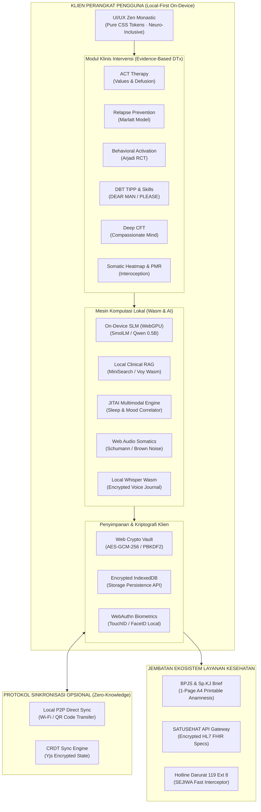

# RIMA Future Plan & Strategic Roadmap (2027–2028)

### Cetak Biru Arsitektur Jangka Panjang & Peta Jalan Digital Therapeutics (DTx) Berbasis Bukti

> **Status Dokumen:** Dokumen Arsitektur & Perencanaan Produk Resmi (Master Strategic Blueprint)  
> **Versi Dokumen:** 3.0.0 (Oktober 2026 – Perencanaan Siklus Rilis 2027–2028)  
> **Klasifikasi:** Open-Source Digital Therapeutics (DTx), Local-First Web/Mobile PWA, & Clinical AI  
> **Kepatuhan Regulasi:** UU Pelindungan Data Pribadi No. 27/2022, UU Kesehatan No. 17/2023, WHO Guidelines on Digital Health Interventions, APA App Advisor Framework, NICE Evidence Standards Framework (ESF) Tier B/C.

---

## 1. Visi Produk, Misi Klinis & Prinsip Abadi

### A. Visi Produk (2027–2028)
Menjadikan **RIMA (Ruang Interaksi Mental Aman)** sebagai ekosistem kesehatan mental digital terdepan di Indonesia dan Asia Tenggara yang menggabungkan:
1. **Otonomi Privasi Mutlak (Zero-Knowledge & Local-First)**: Data batin pengguna adalah hak milik pribadi yang tidak boleh dikomodifikasi atau dibocorkan ke server publik.
2. **Kekakuan Ilmiah (Zero Pseudoscience / Anti-Fitur Halu)**: Menolak generalisasi berbahaya, ramalan emosi pseudosains, atau chatbot manipulatif. Seluruh intervensi berakar pada uji klinis acak (*Randomized Controlled Trials* / RCT) dan meta-analisis medis.
3. **Desain Hening (Calm-Tech & Sensory Regulation)**: Antarmuka yang menenangkan sistem saraf otonom (*vagus nerve*), bebas dari adiksi gamifikasi, polusi visual, dan tekanan sosial.

### B. Misi Klinis & Konteks Indonesia
Menurut **I-NAMHS (2022)** dan **Survei Kesehatan Indonesia (SKI 2023)**, kendala utama penanganan kesehatan jiwa di Indonesia bukan semata-mata ketiadaan informasi, melainkan:
- **Rasio Tenaga Medis Rendah**: Rasio psikiater dan psikolog klinis di Indonesia hanya 1 per 400.000 penduduk (standar WHO adalah 1:30.000), dengan konsentrasi 70% berada di Pulau Jawa.
- **Ketakutan Stigma & Pelanggaran Privasi**: 96,5% individu usia 15–24 tahun enggan berkonsultasi karena takut dicap "kurang iman", dijauhi keluarga, atau data pribadinya bocor.
- **Biaya & Birokrasi Rujukan**: Ketidaktahuan masyarakat mengenai mekanisme pembiayaan BPJS Kesehatan untuk layanan poli jiwa di Puskesmas (FKTP) dan RSUD.

RIMA berperan sebagai **Lini Pertama Pertolongan Mandiri (Self-Guided First-Line Digital DTx)** dan **Jembatan Rujukan Tanpa Hambatan (Frictionless BPJS Healthcare Bridge)**.

---

## 2. Diagram Arsitektur Holistik Sistem Masa Depan



---

## 3. Matriks 4 Kuadran Produk: Tambah, Perbaiki, Perkuat, Kurangi

```
                    TAMBAH (ADD)                                       PERBAIKI (FIX)
      ┌───────────────────────────────────────────────┐   ┌───────────────────────────────────────────────┐
      │ 1. On-Device Small Language Model (SLM)       │   │ 1. Isolasi Viewport & Virtual Keyboard Mobile │
      │ 2. Somatic Body Scan Heatmap Interaktif       │   │ 2. Modul Terjemahan Dinamis per Bahasa (Chunk)│
      │ 3. DBT Skills Lanjutan (DEAR MAN, PLEASE)     │   │ 3. Pemuatan Aset Gambar & Font Zero-CDN       │
      │ 4. Voice Journaling Terenkripsi (Whisper Wasm)│   │ 4. Transisi Layar Hening & Accessible Modals  │
      │ 5. Standar Interoperabilitas HL7 FHIR Medis   │   │ 5. Offline Mutation Queue & Resolusi Konflik  │
      └───────────────────────────────────────────────┘   └───────────────────────────────────────────────┘
                  PERKUAT (STRENGTHEN)                               KURANGI (PRUNE / REMOVE)
      ┌───────────────────────────────────────────────┐   ┌───────────────────────────────────────────────┐
      │ 1. Zero-Knowledge CRDT Multi-Device Sync      │   │ 1. Gamifikasi Beracun ("Toxic Streaks")       │
      │ 2. Pagar Anti-Delusi Chatbot (Ragas Framework)│   │ 2. Polusi Visual Animasi Mencolok & Popups    │
      │ 3. Keamanan Biometrik Lokal (WebAuthn)        │   │ 3. Ketergantungan CDN Eksternal Runtime       │
      │ 4. Web Push VAPID Background Notifications    │   │ 4. Metrik Sosial Kompetitif di Komunitas      │
      │ 5. Jembatan Rujukan Faskes BPJS & SATUSEHAT   │   │ 5. Form Wizard Panjang Tanpa Autosave Draft   │
      └───────────────────────────────────────────────┘   └───────────────────────────────────────────────┘
```

---

## 4. Pilar 1: UI/UX & Sensory Accessibility (Evolusi Zen Monastic)

### A. Filosofi Desain: Hening, Bernapas, dan Menghormati Sistem Saraf
Antarmuka RIMA berevolusi melampaui estetika minimalis visual biasa menjadi **Desain Regulasi Sensorik (Sensory Regulation Design)**:
- **Adaptive Emotional Sensory UI**: Ketika sistem mendeteksi lonjakan distres akut (skor SUDS $\ge 7/10$ atau pemicu kata kunci krisis), antarmuka secara otomatis memadat (*auto-condense*):
  - Menyembunyikan kartu navigasi sekunder (artikel, analitik, pengaturan).
  - Mengubah tampilan Beranda menjadi *Zen Safe Harbor*: tombol de-eskalasi somatik instan, kartu kontak terpercaya, dan tombol panggil 119 Ext 8.
- **Pemberantasan Keyboard Collision pada Mobile**: Form jurnal dan modal wizard menerapkan CSS `interactive-widget=resizes-content` dan hook adaptif `useKeyboardAvoidance` untuk memastikan tombol aksi primer (*Simpan*, *Lanjut*, *Batal*) tidak pernah tertutup oleh keyboard virtual Android atau iOS.
- **Aksesibilitas Kelas Dunia (WCAG 2.2 Level AAA)**:
  - Rasio kontras teks utama minimal **7:1** terhadap latar belakang (melampaui standar AA 4.5:1).
  - Seluruh elemen sentuh (chip emosi, tombol aksi, tab navigasi) mempertahankan ukuran fisik $\ge 48 \times 48\text{ px}$.
  - Visualisasi grafik Recharts dilengkapi alternatif tabel data yang dapat dibaca lancar oleh pembaca layar (*screen reader accessible data tables*).

### B. Palet Suhu Emosional Terkalibrasi (Design Tokens)
- **OLED True Black (`#000000` / `#0A0D12`)**: Untuk penggunaan malam hari, mereduksi paparan cahaya biru (*melatonin preservation*) dan menghemat baterai layar OLED.
- **Paper Warm Linen (`#FBF9F5` / `#F3EFEA`)**: Palet siang hari bernuansa kertas berserat alami yang hangat, ramah bagi mata yang lelah akibat ketegangan visual astigmatisme.
- **Sage Earthy Muted (`#16201B` / `#EBF1ED`)**: Palet peredam kecemasan berbasis pigmen klorofil alami yang meredakan saraf simpatis.

---

## 5. Pilar 2: Fitur Klinis DTx Baru Berbasis Bukti (Anti-Fitur Halu)

Seluruh fitur baru yang direncanakan memiliki landasan ilmiah terverifikasi (*anti-pseudosains*):

| Modul Klinis Masa Depan | Mekanisme Neurobiologis & Psikologis | Dasar Bukti Ilmiah (RCT / Meta-Analisis) | Target Klinis |
| :--- | :--- | :--- | :--- |
| **1. DBT Skills Lanjutan (DEAR MAN & PLEASE)** | Keterampilan asertivitas interpersonal tanpa konflik dan regulasi homeostasis fisik (Sleep, Exercise, Eating, Illness). | Linehan (2014); Valentine et al. (2015), *Psychiatry Research*. | Regulasi emosi borderline, ledakan amarah, & *interpersonal distress*. |
| **2. Somatic Body Scan Heatmap** | Peningkatan interosepsi (*insula cortex activation*) dan lokalisasi sensasi somatik ketegangan fisik. | Critchley et al. (2004), *Nat Neurosci*; Mehling et al. (2018), *PLOS ONE*. | Somatisasi cemas, serangan panik, & ketegangan otot kronis. |
| **3. Deep CFT: Compassionate Letter** | Aktivasi sistem ketenangan internal (*soothing-contentment system*) melalui pelepasan oksitosin endogen. | Gilbert (2014); Ferrari et al. (2019), *Mindfulness* ($g = -0.54$). | Kritik diri ekstrem (*self-criticism*), rasa malu beracun (*toxic shame*). |
| **4. Exposure Therapy Bertahap** | *Inhibitory learning* dan pemadaman respon takut amigdala (*fear extinction*) via SUDS Hierarchies. | Craske et al. (2014), *Behav Res Ther*; Foa et al. (2022). | Fobia spesifik, kecemasan sosial, & penghindaran agorafobik. |
| **5. Sirkadian Sleep Optimization** | Sinkronisasi ritme nukleus suprakiasmatik via pembatasan kafein sirkadian & *dim-light melatonin onset*. | Espie et al. (2019), *JAMA Psychiatry*; Czeisler (2021), *Sleep Med*. | Insomnia kronis, gangguan fase tidur tertunda (DSPS). |

### Spesifikasi Rinci Fitur Klinis:
1. **Somatic Body Scan Heatmap (`/somatics`)**:
   - Kanvas visual tubuh manusia (tampilan depan dan belakang) minimalis dan non-gendered.
   - Pengguna menandai simpul ketegangan (misal: sensasi sesak di dada, leher kaku, perut mual) dengan intensitas 1–10.
   - Sistem memberikan latihan pelepasan somatik terarah: jika dada sesak $\rightarrow$ *Stanford Cyclic Sighing*; jika leher/rahang kaku $\rightarrow$ *PMR Head/Jaw Cycle*.
2. **Keterampilan Interpersonal DBT DEAR MAN (`/dbt-dear-man`)**:
   - Wizard penyusunan kalimat asertif langkah demi langkah:
     - **D**escribe (Jelaskan fakta objektif tanpa penghakiman)
     - **E**xpress (Ekspresikan perasaan dengan kalimat "Aku...")
     - **A**ssert (Sampaikan permintaan spesifik secara jelas)
     - **R**einforce (Jelaskan manfaat positif bagi kedua belah pihak)
     - **M**indful (Tetap fokus pada tujuan, abaikan distraksi)
     - **A**ppear Confident (Postur dan nada bicara tenang)
     - **N**egotiate (Beri ruang kompromi yang seimbang)

---

## 6. Pilar 3: Frontend Architecture, WebAssembly & Mobile Packaging

### A. Komputasi WebAssembly (Wasm) On-Device
Untuk menjaga waktu tanggap antarmuka tetap 60 FPS pada ponsel berspesifikasi rendah di wilayah 3G Indonesia:
- **Kriptografi Argon2id Wasm**: Derivasi kunci enkripsi tahan serangan GPU/ASIC tanpa memblokir peramban.
- **Kuantisasi NLP & Analisis Sentimen Wasm**: Pemrosesan leksikal bahasa Indonesia dan kamus daerah berjalan pada Web Worker terpisah.

### B. Otentikasi Biometrik WebAuthn Tanpa Server
- **WebAuthn Local PIN Unlock**: Menggantikan kebutuhan mengetik 4-digit PIN berulang kali dengan otentikasi biometrik lokal (Touch ID, Face ID, Windows Hello, Android Biometric Prompt).
- **Keamanan Kriptografis Mutlak**: Kunci biometrik diverifikasi oleh modul *Secure Enclave* perangkat; nol data biometrik disimpan di kode aplikasi atau dikirim ke server luar.

### C. Distribusi Aplikasi Native (Capacitor 6 & Tauri v2)
- **Capacitor 6 Packaging**: Penyusunan bundel native Android (`.apk` / `.aab`) dan iOS dengan plugin biometrik, haptic tactile engine, dan status offline-first tersertifikasi.
- **Tauri v2 Mobile Exploration**: Penjajakan arsitektur ultra-ringan berbasis Rust untuk desktop dan mobile dengan ukuran biner $<15\text{ MB}$.

---

## 7. Pilar 4: Backend Zero-Knowledge, CRDT Sync & Interoperabilitas

### A. Sinkronisasi Bebas Konflik Berbasis CRDT (Local-First Sync)
Mengatasi tantangan pengguna yang menggunakan RIMA di lebih dari satu perangkat (misal: ponsel Android dan laptop):
- Menggunakan protokol **Conflict-free Replicated Data Type (CRDT)** (seperti *Yjs* atau *Automerge*).
- Setiap transaksi jurnal atau log emosi dicatat sebagai operasi atomik lokal bertanda waktu kriptografis.
- **Ciphertext Sync**: Payload mutasi disinkronkan ke Supabase Storage dalam kondisi terenkripsi penuh. Server Supabase hanya bertindak sebagai *relay* buta (*blind broker*), tanpa kemampuan mendekripsi dokumen pengguna.

### B. Transfer Data Lokal Antar-Perangkat (Peer-to-Peer Wi-Fi / QR)
Bagi pengguna yang berada dalam **Mode 100% Offline (Air-Gapped)**:
- Migrasi data dari ponsel lama ke ponsel baru dapat dilakukan secara nirkabel melalui jaringan Wi-Fi lokal langsung (P2P WebRTC) atau pemindaian rangkaian kode QR terenkripsi dinamis (*Animated Animated QR Sequences*) tanpa memerlukan akun atau internet.

### C. Standar Interoperabilitas Medis Internasional (HL7 FHIR)
- RIMA mengadopsi standar **HL7 FHIR Release 4** (*Fast Healthcare Interoperability Resources*).
- Data asesmen (PHQ-9, GAD-7, C-SSRS) dapat diekspor ke dalam profil FHIR `Observation` dan `QuestionnaireResponse` berstandar internasional, memudahkan integrasi masa depan dengan sistem rekam medis elektronik rumah sakit.

---

## 8. Pilar 5: Conversational AI, On-Device Small Language Model (SLM) & RAG

### A. Evolusi Arsitektur Tiga Generasi

```
 GENERASI 1 (Saat Ini)                GENERASI 2 (2027)                  GENERASI 3 (2028+)
[Hybrid Vector RAG + BM25]    ──►   [On-Device SLM (WebGPU)]    ──►   [Federated Local Co-Pilot]
• Retrieval psikoedukasi lokal     • Model 100% lokal di browser      • Model beradaptasi dengan gaya
• Rule-based empathy matcher       • SmolLM 135M / Qwen 2.5 0.5B      • bahasa & koping pengguna lokal
• Zero network cost               • Inferensi offline via ONNX Web   • Zero raw data sharing
```

### B. On-Device Small Language Model (SLM) via WebGPU & ONNX Web Runtime
- Menjalankan model bahasa kecil (*Small Language Model*) terkuantisasi 4-bit (misal: **SmolLM-135M-Instruct** atau **Qwen-2.5-0.5B**) langsung di dalam memori WebGPU peramban pengguna.
- **Keunggulan Mutlak**:
  - Nol ketergantungan API pihak ketiga (bebas dari downtime dan biaya bulanan).
  - Privasi 100% mutlak: curahan hati pengguna tidak pernah meninggalkan RAM lokal perangkat.
  - Berfungsi sempurna di area tanpa sinyal seluler atau saat mode pesawat (*Air-Gapped*).

### C. Pagar Pembatas Klinis & Anti-Delusi (Clinical Guardrails)
1. **Evaluasi Ragas Framework**:
   - *Faithfulness Metric* $\ge 0.95$: Setiap respons chatbot wajib bersumber langsung dari korpus psikoedukasi terverifikasi.
   - *Answer Relevance Metric* $\ge 0.90$: Respons berfokus pada validasi emosi dan psikoedukasi, bukan analisis abstrak.
2. **Pemberantasan Premis Delusi (*Anti-Sycophancy Guardrail*)**:
   - Jika pengguna menulis narasi halusinatif atau delusi penganiayaan/paranoid (*"Tetangga memasang radar di otakku"*), chatbot **dilarang memvalidasi atau memperkuat premis tersebut**.
   - Model dilatih untuk membelokkan fokus secara lembut ke regulasi emosi: *"Aku mendengar betapa melelahkan dan mencemaskannya perasaan ini bagimu. Mari kita tarik napas sejenak bersama."*
3. **Penyekatan Batas Kedokteran (*Non-Diagnostic Shield*)**:
   - Menolak secara tegas pertanyaan yang meminta resep obat, diagnosis psikiatri formal, atau ramalan masa depan.

---

## 9. Pilar 6: Jurnal & Refleksi Terapeutik Lanjutan

### A. Protokol Expressive Writing (James Pennebaker)
- *Dasar Klinis*: Pennebaker & Beall (1986); Smyth et al. (2018), *JAMA*. Penulisan emosional terstruktur selama 4 sesi berturut-turut terbukti menurunkan kunjungan ke dokter, meregulasi biomarker imunitas, dan mereduksi ruminasi traumatis.
- *Desain Fitur*: Sesi menulis terpandu 15–20 menit dengan timer hening, disertai pengukur kesiapan emosional pra-sesi dan protokol de-eskalasi pasca-sesi jika tulisan memicu kesedihan mendalam.

### B. CBT Downward Arrow Technique (Penyingkap Core Beliefs)
- *Dasar Klinis*: Judith Beck, *Cognitive Behavior Therapy: Basics and Beyond*.
- *Alur Interaktif*: Mengajak pengguna menelusuri lapisan pikiran otomatis hingga ke keyakinan inti (*Core Belief*):
  - *"Apa yang terjadi jika proyek ini gagal?"* $\rightarrow$ *"Orang lain akan kecewa."*
  - *"Jika mereka kecewa, apa artinya itu bagimu?"* $\rightarrow$ *"Aku tidak cukup pintar."*
  - *"Dan jika kamu tidak cukup pintar, apa artinya itu tentang dirimu?"* $\rightarrow$ **Core Belief: "Aku tidak berharga."**
- Dilanjutkan dengan reframing welas asih berbasis bukti untuk menetralkan keyakinan inti tersebut.

### C. Voice Journaling Terenkripsi Lokal (Whisper Web Wasm)
- Memungkinkan pengguna mencurahkan isi hati melalui suara tanpa mengetik (berguna saat tangan gemetar atau sedang kelelahan fisik).
- Model **Whisper-Tiny** berjalan 100% di browser via WebAssembly: audio ditranskripsikan ke teks di perangkat, dan berkas audio mentah segera dihapus setelah selesai ditranskripsikan demi perlindungan privasi.

---

## 10. Pilar 7: Jembatan Faskes BPJS, SATUSEHAT & Riset Klinis

### A. Lembar Anamnesis Klinis 1-Halaman A4 (Dokter Puskesmas / Sp.KJ)
- Mengatasi keterbatasan waktu konsultasi dokter BPJS (yang sering kali hanya berlangsung 3–7 menit per pasien):
- RIMA menghasilkan ringkasan medis PDF 1-halaman A4 yang terstruktur rapi:
  - Grafik tren 30-hari skor PHQ-9 & GAD-7.
  - Stratifikasi risiko C-SSRS dan pemicu dominan.
  - Riwayat efisiensi tidur CBT-I dan aktivitas koping yang efektif.
  - **Nol Kebocoran Isi Jurnal Pribadi**: Menghargai kerahasiaan batin pengguna dengan hanya menyajikan data kuantitatif agregat klinis.

### B. Penjajakan Integrasi SATUSEHAT Kemenkes RI
- Menganalisis arsitektur pertukaran data rekam medis personal dengan platform SATUSEHAT Kementerian Kesehatan Republik Indonesia:
- Hanya dapat diaktifkan secara sukarela (*opt-in*) dengan persetujuan eksplisit bertanda tangan digital, memastikan kepatuhan penuh terhadap UU PDP No. 27/2022.

### C. Desain Metodologi Uji Klinis Acak (RCT) dengan Universitas
- Rencana pelaksanaan *Pragmatic Randomized Controlled Trial (RCT)* bekerja sama dengan Fakultas Psikologi dan Fakultas Kedokteran universitas di Indonesia:
- **Desain Uji**: 2-Arm Trial (Kelompok Intervensi RIMA vs Kelompok Kontrol Daftar Tunggu / Psikoedukasi Minimal).
- **Hasil Ukur Primer**: Penurunan skor PHQ-9 dan GAD-7 pada minggu ke-4 dan minggu ke-8.
- **Hasil Ukur Sekunder**: Peningkatan skor WHO-5 Well-Being Index dan efisiensi tidur CBT-I.

---

## 11. Pentahapan Rilis Strategis (Roadmap Milestones 2027–2028)

```
        2027                                                2028
  Q1      Q2      Q3      Q4                  Q1      Q2      Q3      Q4
───┬───────┬───────┬───────┬───────────────────┬───────┬───────┬───────┬───►
   │       │       │       │                   │       │       │       │
 Fase 13 Fase 14 Fase 15 Fase 16             Fase 17 Fase 18 Fase 19 Fase 20
```

### Fase 13: Somatic Heatmap & Advanced DBT Skills (Target: Q1 2027)
- [ ] Peluncuran modul **Somatic Body Scan Heatmap** dengan pemetaan titik ketegangan tubuh interaktif.
- [ ] Implementasi **DBT DEAR MAN Wizard** untuk panduan komunikasi asertif.
- [ ] Peningkatan aksesibilitas WCAG 2.2 Level AAA dan perbaikan keyboard avoidance pada seluruh modal dialog.
- [ ] Chunking modul terjemahan dinamis per bahasa untuk memangkas bundle awal ponsel 3G.

### Fase 14: Zero-Knowledge CRDT Multi-Device Sync (Target: Q2 2027)
- [ ] Integrasi mesin sinkronisasi **CRDT Yjs** terenkripsi klien di atas Supabase.
- [ ] Fitur **Local P2P Direct Transfer** antar-perangkat via Wi-Fi lokal dan QR Code dinamis.
- [ ] Penyempurnaan penanganan *offline mutation queue* di IndexedDB.
- [ ] Rilis pembungkus native **Capacitor 6 Android & iOS** dengan biometrik WebAuthn.

### Fase 15: Pennebaker Writing & Downward Arrow CBT (Target: Q3 2027)
- [ ] Implementasi **Protokol Expressive Writing Pennebaker 4-Hari**.
- [ ] Wizard interaktif **Downward Arrow Technique** untuk pemetaan *Core Beliefs*.
- [ ] Penambahan generator laporan konsultasi dokter 1-halaman A4 yang dioptimalkan untuk cetak dan PDF.
- [ ] Background notifications terjadwal menggunakan Web Push VAPID API.

### Fase 16: On-Device Small Language Model (SLM) & Whisper Wasm (Target: Q4 2027)
- [ ] Integrasi inferensi lokal model bahasa kecil (SmolLM / Qwen 0.5B 4-bit) via WebGPU dan ONNX Web Runtime.
- [ ] Pengujian automated benchmark evaluasi Ragas (*Faithfulness* $>0.95$).
- [ ] Fitur **Voice Journaling Terenkripsi** menggunakan Whisper-Tiny Wasm lokal.
- [ ] Penguatan perlindungan *anti-sycophancy* dan triage krisis C-SSRS multi-bahasa daerah.

### Fase 17: Interoperabilitas SATUSEHAT & Standar HL7 FHIR (Target: H1 2028)
- [ ] Penyusunan spesifikasi data klinis terstandarisasi HL7 FHIR R4.
- [ ] Penjajakan pilot project integrasi rekam medis sukarela dengan SATUSEHAT Kemenkes RI.
- [ ] Pembangunan dashboard edukasi anonim untuk institusi kampus/pendidikan tinggi dengan diferensial privasi ($\epsilon \le 0.5$).

### Fase 18: Uji Klinis Acak (RCT) & Kolaborasi Riset Medis (Target: H2 2028)
- [ ] Pelaksanaan studi uji klinis terkontrol acak (RCT) dengan mitra akademis di Indonesia.
- [ ] Publikasi temuan efikasi klinis RIMA pada jurnal ilmiah psikologi/kesehatan digital internasional bereputasi (*The Lancet Digital Health / JMIR*).
- [ ] Pembentukan konsorsium tata kelola open-source (*Open Digital Therapeutics Governance Consortium*).

---

## 12. Matriks Manajemen Risiko & Mitigasi Teknis/Etis

| Risiko Teknis / Etis | Tingkat Risiko | Dampak | Strategi Mitigasi Terstruktur |
| :--- | :--- | :--- | :--- |
| **Keterbatasan VRAM Ponsel untuk Model SLM** | Tinggi | Aplikasi crash / OOM pada perangkat low-end. | Deteksi kapabilitas WebGPU saat startup; jika tidak memadai, sistem otomatis fallback ke Hybrid Vector RAG tanpa degradasi fitur inti. |
| **Penyalahgunaan Chatbot Sebagai Pengganti Psikiater** | Kritis | Pasien menunda pengobatan klinis esensial. | Pagar pembatas disclaimer klinis permanen di header chat; pembatasan dialog multi-turn; deteksi gejala berat otomatis dialihkan ke hotline 119 Ext 8. |
| **Kebocoran Kunci Enkripsi Akibat Malware di Perangkat** | Sedang | Data lokal terekspos pada perangkat yang di-root/jailbreak. | Derivasi kunci volatile hanya disimpan di memori sesi aktif; auto-lock saat aplikasi diminimalkan; proteksi salt 16-byte unik per perangkat. |
| **Kelelahan Emosional pada Expressive Writing** | Sedang | Peningkatan distres sementara (*temporary emotional vulnerability*). | Skrining kesiapan emosional wajib sebelum menulis; tombol jeda darurat satu sentuhan yang langsung membuka panduan napas *Cyclic Sighing*. |
| **Perubahan Format Regulasi SATUSEHAT Kemenkes** | Rendah | Kendala kompatibilitas data rekam medis. | Isolasi modul integrasi dalam adapter arsitektur terpisah berbasis standar internasional HL7 FHIR yang agnostik terhadap API nasional. |

---

## 13. Kepatuhan Regulasi & Standar Etika Global

1. **UU Pelindungan Data Pribadi No. 27/2022 (Indonesia)**:
   - Menetapkan data suasana hati, skor psikometrik, dan isi jurnal sebagai **Data Pribadi yang Bersifat Spesifik**.
   - Hak mutlak pengguna untuk menghapus seluruh data secara lokal maupun remote (*Right to Erasure*) dijamin dalam 1 ketukan.
   - Tidak ada transfer data lintas batas negara (*cross-border data transfer*) tanpa enkripsi kunci privat pengguna.
2. **UU Kesehatan No. 17/2023 & Standar Permenkes RI**:
   - Memastikan batas tegas antara alat bantu refleksi mandiri (*wellness support tool*) dan alat diagnosis medis formal (*Software as a Medical Device* / SaMD).
   - Seluruh instrumen penapisan (PHQ-9, GAD-7, WHO-5, C-SSRS) menggunakan translasi dan validasi klinis yang telah dipublikasikan di Indonesia.
3. **WHO Guidelines on Ethics & Governance of AI for Health**:
   - Menolak *black-box algorithms* yang tidak transparan.
   - Menjamin bahwa sistem kecerdasan buatan dalam RIMA mengutamakan otonomi manusia, keadilan akses tanpa memandang status ekonomi, dan perlindungan privasi tanpa kompromi.

---

<div align="center">

**RIMA — Menghadirkan Ruang Aman Berbasis Sains, Menjaga Martabat & Hak Privasi Setiap Insan**

*Dokumen ini merupakan panduan strategis resmi yang ditinjau dan diperbarui secara berkala bersama konsorsium pengembang dan dewan penasihat klinis.*

</div>
